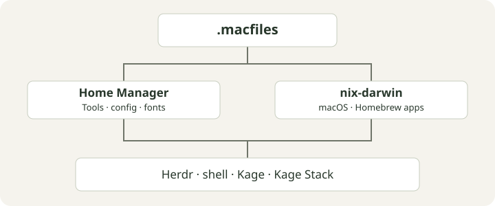

# .macfiles

My Mac's apps, tools and settings. Home Manager owns user configuration. nix-darwin owns macOS settings and Homebrew.

## Open the handbook

```sh
nix run ~/.macfiles#docs
```

Read it at **http://127.0.0.1:4178**. Search, keyboard navigation, and light and dark themes work locally.

| I want to | Read |
|---|---|
| Set up another Mac | [Installation](docs/src/setup.md) |
| Find the owning file | [Configuration map](docs/src/structure.md) |
| Change tools or settings | [Changes and updates](docs/src/changes.md) |
| Use terminal and agent layouts | [Herdr](docs/src/herdr.md) |
| Find shell and tmux shortcuts | [Terminal workflow](docs/src/terminal.md) |
| Understand Kage and Kage Stack | [Agent tools](docs/src/agents.md) |
| Undo a broken change | [Recovery](docs/src/recovery.md) |
| Pick the next improvement | [Ideas worth trying](docs/src/ideas.md) |

## Work on the configuration

```sh
cd ~/.macfiles
nix fmt
nix flake check
```

Apply user changes with `nh home switch`. Apply system changes with `sudo darwin-rebuild switch --flake ~/.macfiles#maccy`.

Keep the root flat: `flake.nix`, `home.nix`, `darwin.nix`, `config/`, `fonts/`, and `docs/`. `flake.lock` pins Nix inputs. Homebrew apps, Herdr and shell plugins update separately.

This repo is public. Private overrides, credentials and runtime state stay outside it. Homebrew activation removes unlisted packages. Review `darwin.nix` before switching.
