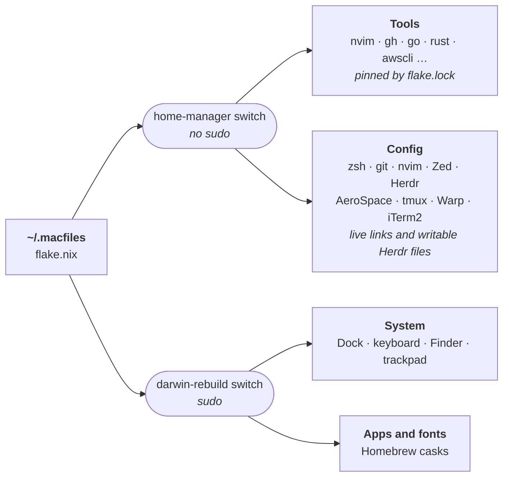

# .macfiles



My Mac's apps, tools and settings. Home Manager owns user files. nix-darwin owns macOS settings and Homebrew.

## Set up a new Mac

1. Install Nix:
   ```sh
   curl -fsSL https://install.determinate.systems/nix | sh -s -- install
   ```
2. Open a new terminal, then clone this repo:
   ```sh
   git clone https://github.com/aloki-alok/.macfiles ~/.macfiles
   ```
3. Apply the system layer (macOS settings, Homebrew and its apps). If it stops on a file in `/etc`, rename that file to `<name>.before-nix-darwin` and run it again:
   ```sh
   sudo nix run nix-darwin -- switch --flake ~/.macfiles#maccy
   ```
4. Apply the home layer (tools and dotfiles):
   ```sh
   nix run home-manager/master -- switch --flake ~/.macfiles#ryu -b bak
   ```
5. Create `~/.gitconfig.local` with your `user.email` and `user.signingkey`.
6. Install Herdr with its [official installer](https://herdr.dev/download/), then open it:
   ```sh
   curl -fsSL https://releases.herdr.dev/app/install.sh | sh
   ```
7. Open a new terminal. If you use Firefox, open it once, then run `nh home switch` to style it.

`-b bak` moves any file in the way to `<name>.bak` instead of failing.

## Everyday use

| I want to | Do this |
|---|---|
| Add a CLI tool | Add its name to `home.packages` in `home.nix`, then run `nh home switch` |
| Add an app or font | Add its cask to `homebrew.casks` in `darwin.nix`, then run `sudo darwin-rebuild switch --flake ~/.macfiles` |
| Change a macOS setting | Edit `system.defaults` in `darwin.nix`, then run `darwin-rebuild` as above |
| Try a tool once | `nix run nixpkgs#cowsay`. Nothing stays installed |
| Change a config file | Edit it in `config/`. Herdr panels need `nh home switch`; other files use live links |
| Update every tool | `nix flake update --flake ~/.macfiles`, then `nh home switch` |
| Undo the last switch | `home-manager switch --rollback` |
| See past versions | `home-manager generations` |
| Check the configuration | `nix flake check` |
| Find a package name | [search.nixos.org/packages](https://search.nixos.org/packages) |

`nh home switch` shows what changed before it applies. Nix deletes generations older than 30 days every week.

## AeroSpace shortcuts

Hold **Option** for window management. Arrow and Backspace shortcuts stay available for text editing in apps.

| Key with Option | Action |
|---|---|
| H, J, K, L | Focus left, down, up, right |
| Shift + H, J, K, L | Move left, down, up, right |
| 1–9 | Switch workspace |
| Shift + 1–9 | Move the window to that workspace and follow it |
| Tab | Return to the previous workspace |
| F | Toggle fullscreen |
| V | Toggle floating |
| Slash | Cycle tile orientation |
| Comma | Cycle accordion orientation |
| Minus or equal | Shrink or grow the window |

There is one binding mode. AeroSpace has no Backspace binding or shortcut that closes windows.

## What lives where

```
.macfiles/
├── flake.nix        inputs, checks, ryu (home) and maccy (system)
├── flake.lock       exact versions of every input. Commit it
├── home.nix         home layer: tools, git, links, fonts
├── darwin.nix       system layer: macOS settings, Homebrew taps, formulae and casks
├── config/          app configuration and Herdr panels
│   ├── zshrc            → ~/.zshrc
│   ├── nvim/            → ~/.config/nvim
│   ├── zed/             → ~/.config/zed/settings.json
│   ├── herdr/           → preferences linked live; panels deployed by Home Manager
│   ├── aerospace.toml   → ~/.aerospace.toml
│   ├── tmux/            → ~/.config/tmux
│   ├── warp/            → ~/.warp/settings.toml
│   ├── iterm2/          → iTerm2 dynamic profiles (color themes)
│   ├── starship.toml    → ~/.config/starship.toml
│   ├── atuin/ bat/ btop/ → their files in ~/.config
│   └── firefox/         → user.js and userChrome.css in the default profile
└── fonts/           custom fonts and their licenses, installed by Home Manager
```

Config files stay as plain files on purpose. Apps like lazy.nvim, Herdr and Zed write to their own config, and you edit zshrc too often to rebuild each time.

## Herdr

`config/herdr` holds settings, keys, personal layouts, panels, themes and their tests. Settings and keys link live into `~/.config/herdr-app`. Home Manager deploys the other files as writable copies so Herdr's imports and file watchers work. Edit panel code, layouts and themes in this repo, stage new files, then run `nh home switch`.

Terminal mode shows task titles across the top. Agents mode shows them in the sidebar. Cmd+1–9 follow the visible numbered agents in Agents mode and select tabs in Terminal mode.

Appearance selections save immediately to the linked settings. Kage and Kage Stack palettes each have day and night variants. Sakura remains available in both variants. The earlier Kawaii layout is kept as an alternative.

Fonts selected in Appearance must also be installed on a new Mac. `AnthropicMonoWeb Nerd Font` is machine-local and is not redistributed here. Herdr falls back to its bundled JetBrains Mono when a selected family is unavailable.

A fresh setup starts in Agents mode with Files and Changes available. Activation leaves existing Herdr state alone. Sessions, selected tabs, window positions, generated declarations and caches stay outside Git. Herdr owns its shipped panels and updates its app and core itself.

`nix flake check` runs the panel logic tests. To check a panel against the installed app, run `herdr-app check config/herdr/mods/<name>`.

## Rules

- Each tool has one source. If Nix installs it, remove the Homebrew copy. `home.nix` lists the formulae that stay in Homebrew and why.
- Install apps through `darwin.nix`, not `brew install`. Each switch uninstalls any formula, cask or tap that `darwin.nix` doesn't list.
- This repo is public. Tokens, SSH config and machine-only aliases go in `~/.zshrc.local`. Git identity goes in `~/.gitconfig.local`. Git never sees either file.
- Leave `home.stateVersion` and `system.stateVersion` alone. They pin defaults, not package versions.
- A flake reads only files git tracks. If you add a file and Nix says it is missing, run `git add` on it.

## Theme

Tokyo Night (night) in Neovim, Zed, iTerm2 (`config/iterm2/noir.json`), bat, btop, fzf and `ls` colors. The shared palette is `config/nvim/lua/noir/palette.lua`. Herdr uses the selected palette in `config/herdr/settings.json`.

iTerm2 profiles use JetBrainsMono Nerd Font. Herdr uses its selected family. The prompt uses Nerd Font glyphs. Anthrosevka Mono also carries them. It is a custom Iosevka build from [nanxstats/anthrosevka](https://github.com/nanxstats/anthrosevka) under SIL OFL 1.1 (`fonts/OFL.txt`).

Geist Pixel Square and Pixel Square Mono are included under SIL OFL 1.1 (`fonts/OFL-GeistPixel.txt`). Other fonts come from the casks in `darwin.nix`.

The Firefox CSS asks for `Anthropic Sans Web` and `AnthropicMonoWeb Nerd Font`. This repo does not ship those fonts. Without them, Firefox falls back to the system sans.
