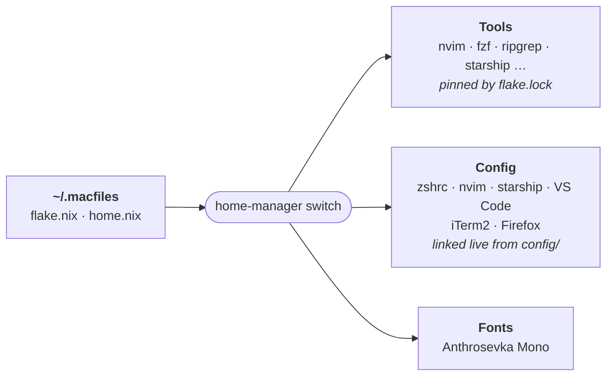

# .macfiles

My Mac, written down. One command turns a fresh MacBook into mine: the same tools, shell, editor, fonts and Noir theme every time.



## Set up a new Mac

1. Install Nix:
   ```sh
   curl -fsSL https://install.determinate.systems/nix | sh -s -- install
   ```
2. Open a new terminal, then clone this repo:
   ```sh
   git clone https://github.com/aloki-alok/.macfiles ~/.macfiles
   ```
3. Apply it:
   ```sh
   nix run home-manager/master -- switch --flake ~/.macfiles#ryu -b bak
   ```
4. Open a new terminal. If you use Firefox, open it once, then run `nh home switch` to style it.

`-b bak` moves any file in the way to `<name>.bak` instead of failing.

## Everyday use

| I want to | Do this |
|---|---|
| Add a CLI tool | Add its name to `home.packages` in `home.nix`, then run `nh home switch` |
| Try a tool once | `nix run nixpkgs#cowsay`. Nothing stays installed |
| Change zsh, nvim or starship | Edit the file in `config/`. It applies at once, no rebuild |
| Update every tool | `nix flake update --flake ~/.macfiles`, then `nh home switch` |
| Undo the last switch | `home-manager switch --rollback` |
| See past versions | `home-manager generations` |
| Find a package name | [search.nixos.org/packages](https://search.nixos.org/packages) |

`nh home switch` shows what changed before it applies.

## What lives where

```
.macfiles/
├── flake.nix        inputs (nixpkgs, home-manager) and the one config: ryu
├── flake.lock       exact versions of every input. Commit it
├── home.nix         everything that gets applied: tools, links, fonts
├── config/          raw files, linked live into place
│   ├── zshrc            → ~/.zshrc
│   ├── nvim/            → ~/.config/nvim
│   ├── starship.toml    → ~/.config/starship.toml
│   ├── vscode/          → VS Code settings.json
│   ├── iterm2/          → iTerm2 dynamic profiles (color themes)
│   └── firefox/         → user.js and userChrome.css in the default profile
└── fonts/           Anthrosevka Mono, installed to ~/Library/Fonts/HomeManager
```

## Two kinds of files

| Kind | Where | How a change applies |
|---|---|---|
| Tools and fonts | `home.nix` | Run `nh home switch` |
| Config files | `config/` | Applies at once. The link points straight at the repo |

Config files stay as plain files on purpose. lazy.nvim writes its lock file into the nvim folder, and you edit zshrc too often to rebuild each time.

## Rules

- Each tool has one source. If Nix installs it, remove the Homebrew copy.
- This repo is public. Tokens, SSH config and machine-only aliases go in `~/.zshrc.local`, which zshrc loads and git never sees.
- Leave `home.stateVersion` alone. It pins defaults, not package versions.
- A flake reads only files git tracks. If you add a file and Nix says it is missing, run `git add` on it.

## Theme

Noir everywhere: iTerm2 (`config/iterm2/noir.json`), VS Code (`config/vscode/settings.json`, "Noir Dark") and Neovim (`config/nvim/colors/noir.lua`, palette in `config/nvim/lua/noir/palette.lua`).

The prompt uses Nerd Font glyphs. Anthrosevka Mono carries them. It is a custom Iosevka build from [nanxstats/anthrosevka](https://github.com/nanxstats/anthrosevka) under SIL OFL 1.1 (`fonts/OFL.txt`).

The Firefox CSS asks for `Anthropic Sans Web` and `AnthropicMonoWeb Nerd Font`. This repo does not ship those fonts. Without them, Firefox falls back to the system sans.

## Not yet

- macOS settings (Dock, key repeat, Touch ID for sudo) and apps (Homebrew casks) by nix-darwin.
- Remaining Homebrew CLI tools, moved over a few at a time.
