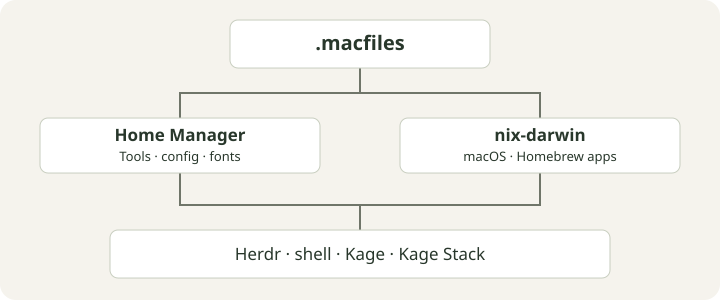

# The daily setup

This handbook explains the Mac I use each day. The configuration lives in `.macfiles`. Search with **S** or **/**.

| I need to | Read |
|---|---|
| Find the file that controls an app | [Who owns each setting](structure.md) |
| Rebuild the setup on another Mac | [Set up a Mac](setup.md) |
| Add a tool or apply an update | [Change and update the setup](changes.md) |
| Switch agents, layouts, fonts or themes | [Use Herdr](herdr.md) |
| Work in the terminal | [Use the shell and tmux](terminal.md) |
| Check the agent hub or coding rules | [Kage and Kage Stack](agents.md) |
| Undo a broken change | [Recover a working setup](recovery.md) |
| Pick the next improvement | [Ideas worth trying](ideas.md) |

The handbook describes configuration, not a full machine backup. Homebrew apps, Herdr releases and shell plugins update outside `flake.lock`.

The repo is public, even when this site runs locally. Credentials, personal messages and private infrastructure details belong elsewhere.
